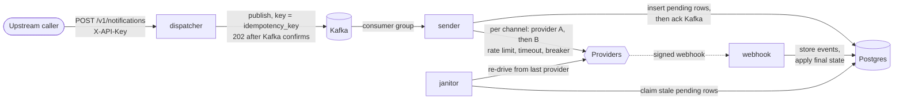
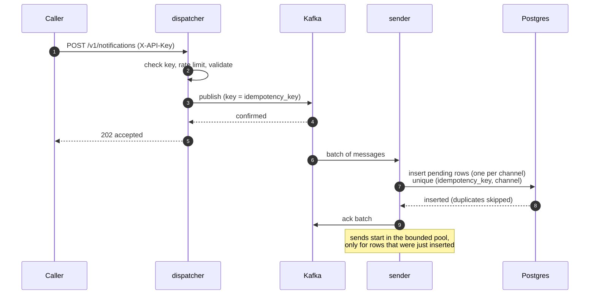
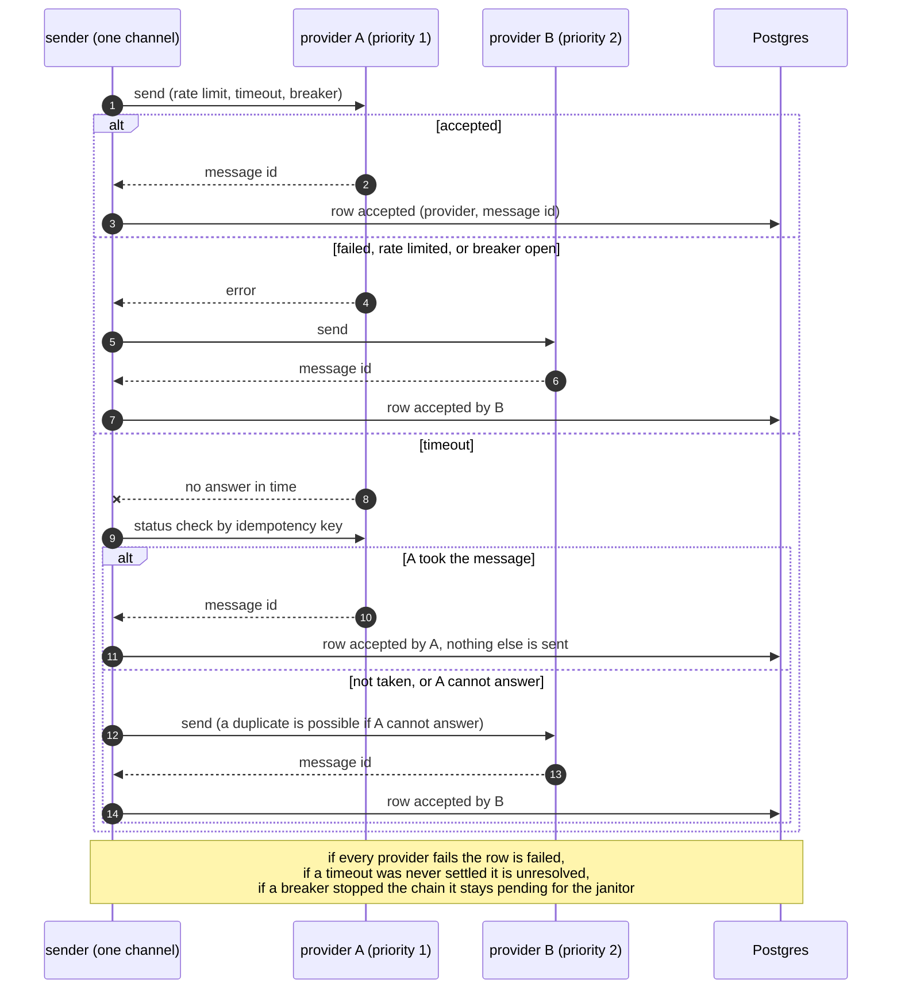
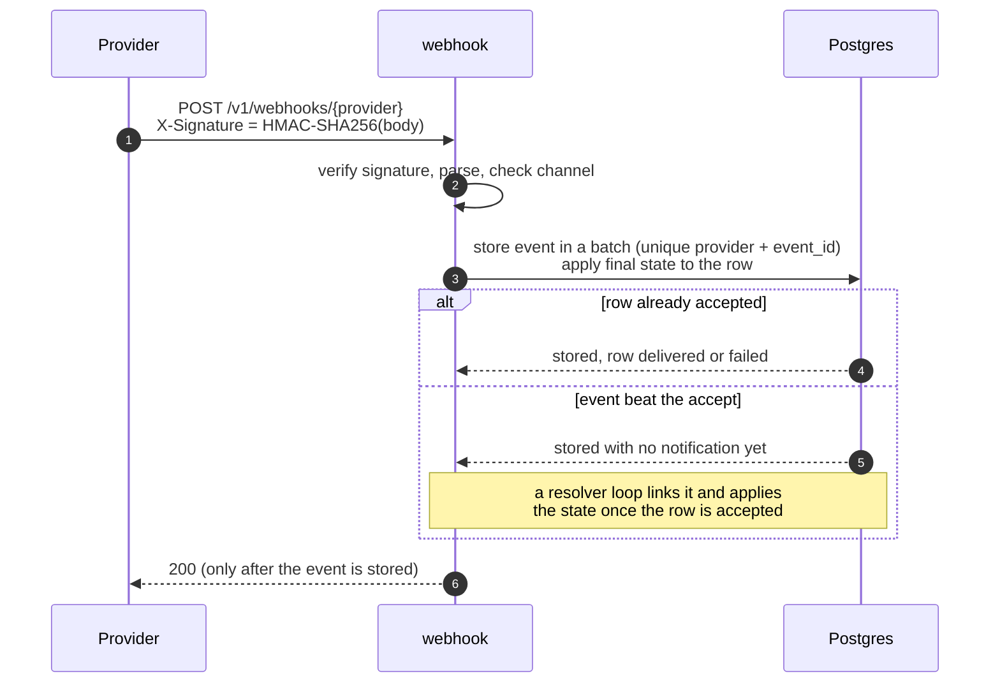
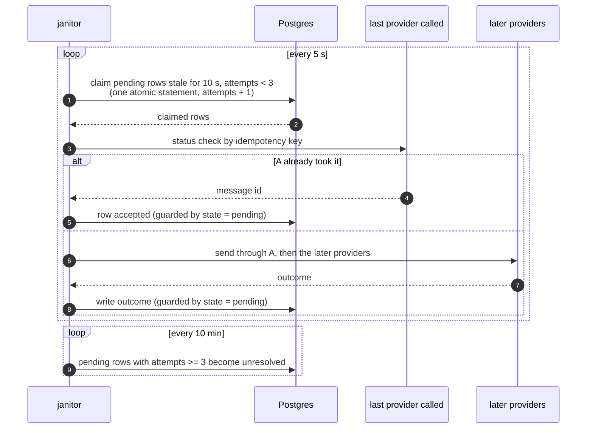

# Eshaar

Eshaar is a notification system. An upstream service sends one request carrying one notification for one user, and Eshaar delivers it over **email, SMS and WhatsApp** through external providers (simulated here by a mock). It is written in Go on Postgres and Kafka.

## The problem it solves

A scheduled event, such as the start of a football match, makes millions of users need a message at the same moment. The system has to:

- accept requests very fast, at a **peak of 500,000 requests per second**, and answer the caller without waiting for any provider;
- **deliver in under 5 seconds** when things go well, using a fallback provider when the first one fails, is slow or is rate limited;
- **never lose a notification and avoid sending one twice**, even when a process crashes, Kafka redelivers, or a provider takes a message and loses the reply;
- record what happened to every notification and channel, including the delivery reports that providers send back later by webhook;
- recover by itself from the failures that cannot be avoided.

The caller sends the channels the user opted into and Eshaar handles delivery. It does not decide who should be notified: opt-ins, user preferences and send limits belong to the upstream service.

## Assumptions the design is based on

These are the assumptions behind the design. The decision log has the reasoning; the places where an assumption is a weak point are marked.

**Scope**

1. One request is one notification for one user. The caller sends only the channels the user opted into, so Eshaar never checks opt-ins, preferences or send limits.
2. Peak load (500K requests/s) comes from a scheduled event and is short, so the backlog can wait in Kafka and clear afterwards.
3. Providers are simulated by a mock that can succeed, fail, delay, rate limit, take a message and lose the reply, and report delivery or failure by webhook. There are no real provider integrations.
4. Authentication is an API key and nothing else. There are no per-key permissions.

**Delivery**

5. The 5-second target is for the first successful attempt, including failover after a transient error. It is not a guarantee: a provider timeout sits outside it, and the janitors recover what it misses.
6. The order of one user's notifications does not matter, so Kafka is keyed by idempotency key, not by recipient, and a very active user cannot create a hot partition.
7. The caller's idempotency key is unique per notification and stable across retries. It is the dedupe key everywhere: Kafka redelivery, janitor re-drives and provider status checks.
8. A notification delivered twice is worse than a delay but better than a loss. When a provider times out and cannot report status, the system falls over to the next provider and accepts a possible duplicate (a weak point, documented as a trade-off).
9. Providers can, in the best case, answer "did you take this idempotency key?". Where they cannot, duplicates are possible.

**Webhooks**

10. Providers sign every webhook with an HMAC-SHA256 of the body, with a secret shared per provider, and send only final states (`delivered` or `failed`).
11. A provider returns a message id on accept, and echoes the idempotency key for sends that timed out. That is how an event is matched to a row. Real providers may need a different matching key (a weak point).
12. A webhook never triggers a fallback. The first final state wins.

**Scale and operations**

13. Postgres is the system of record, and saving a row before sending is worth its cost on the hot path, because it makes redeliveries and re-drives safe. At full scale this needs sharding by idempotency key and batched writes; the load test shows it is the first bottleneck.
14. Rate limiting is per dispatcher instance, not global.
15. Processes are stateless apart from in-memory breakers and limiters, which are per process. Several instances of each can run.
16. Infrastructure is docker-compose, not Kubernetes. Contact details are stored per channel row; encryption and retention are noted in the solution document but not built.

## Documents

| Document | What it is |
| --- | --- |
| [`docs/solution.md`](docs/solution.md) | The solution document: architecture, trade-offs, difficulties, load test summary, scaling to 500K/s, ideas for a better solution |
| [`docs/decision_log.md`](docs/decision_log.md) | Every design decision and why. The base of the solution document, kept current when a decision changes |
| [`docs/implementation_plan.md`](docs/implementation_plan.md) | The seven phases, what each delivers, its tests and its status |
| [`docs/api.md`](docs/api.md) | The HTTP endpoints, request and response rules, and configuration |
| [`docs/load_test.md`](docs/load_test.md) | Load test and provider failure results, with the commands to reproduce them |
| [`docs/benchmarks.md`](docs/benchmarks.md) | Micro-benchmarks of the hot paths with a baseline |
| [`CLAUDE.md`](CLAUDE.md) | Working rules for the repository: commands, commit rules, workflow, architecture rules |

### Plans under `_plans/`

Each phase started with a plan written before the code. They record the context, the steps, and the decisions taken with the author.

| Plan | Phase |
| --- | --- |
| [`phase-1-foundations.md`](_plans/phase-1-foundations.md) | Hexagonal layout, configuration, migrations, local environment, domain and state machine |
| [`phase-2-dispatcher.md`](_plans/phase-2-dispatcher.md) | HTTP endpoint with API key, rate limit and validation, publishing to Kafka |
| [`phase-3-sender.md`](_plans/phase-3-sender.md) | Consumer group that saves before acking, bounded send pool |
| [`phase-4-providers.md`](_plans/phase-4-providers.md) | Provider chains, fallback, circuit breaker, status check on timeout |
| [`phase-5-webhooks.md`](_plans/phase-5-webhooks.md) | Signed webhook endpoint, batched ingest, resolving events to rows |
| [`phase-6-janitors.md`](_plans/phase-6-janitors.md) | Recovery janitor and sweeper, the extracted `Deliverer` |
| [`phase-7-load-test-and-docs.md`](_plans/phase-7-load-test-and-docs.md) | Load test, provider failure runs, API docs and solution document |

### Session logs under `docs/sessions/`

One log per phase, written at the end of the phase from the AI agent session that built it. Each records the flow, the changes from the plan, the review findings that were acted on or skipped, the verification, and the state at the end. Together they are the record of how the project was built with the agent.

| Log | Phase |
| --- | --- |
| [`2026-10-19-phase-1-foundations.md`](docs/sessions/2026-10-19-phase-1-foundations.md) | Foundations |
| [`2026-10-19-phase-2-dispatcher.md`](docs/sessions/2026-10-19-phase-2-dispatcher.md) | Dispatcher |
| [`2026-10-19-phase-3-sender.md`](docs/sessions/2026-10-19-phase-3-sender.md) | Sender |
| [`2026-10-19-phase-4-providers.md`](docs/sessions/2026-10-19-phase-4-providers.md) | Providers and fallback |
| [`2026-10-19-phase-5-webhooks.md`](docs/sessions/2026-10-19-phase-5-webhooks.md) | Webhooks |
| [`2026-10-19-phase-6-janitors.md`](docs/sessions/2026-10-19-phase-6-janitors.md) | Janitors |
| [`2026-10-19-phase-7-load-test-and-docs.md`](docs/sessions/2026-10-19-phase-7-load-test-and-docs.md) | Load test, API docs and solution document |

## Architecture

The code follows a **hexagonal architecture** (ports and adapters), so channels, providers, the queue and the database are replaceable adapters. The import direction is kept by convention and checked in review:

| Package | Role | Imports |
| --- | --- | --- |
| `internal/domain` | Notification, channel, request validation, the forward-only state machine | nothing from the project or infrastructure |
| `internal/ports` | Interfaces for publishing, consuming, storing, sending through a provider, webhooks and the janitor store | the domain only |
| `internal/sender`, `internal/webhook`, `internal/janitor` | The services: sender (batch loop, bounded pool, provider chain, rate limiter, breaker), webhook (signature, parsing, batching, resolving) and the recovery and sweeper loops | the domain and ports only |
| `internal/adapters` | `kafka`, `postgres`, `mock` (the simulated provider), `httpapi` | ports and the domain, never each other |
| `cmd/{dispatcher,sender,webhook,janitor}` | The only places that wire adapters to ports; each is its own process | everything it needs |
| `cmd/migrate`, `cmd/loadtest` | Migration tool and load generator | |
| `internal/platform` | Logging and configuration | |

## System design



- **Four processes, one image.** The dispatcher accepts fast, Kafka holds the work, the sender delivers and records every outcome, the webhook records final states, and the janitor recovers what stalls. Each scales and fails on its own.
- **Save before send.** The sender inserts one `pending` row per channel (unique on idempotency key plus channel) and only then acks Kafka, so a redelivery is absorbed by the unique constraint.
- **Bounded concurrency.** Sends run in goroutines off the consume loop, bounded by a pool. When the pool is full the consumer stops reading and the backlog waits in Kafka.
- **Provider chain per channel.** Providers are ordered by priority, each with its own rate limit, call timeout and circuit breaker, configured in [`infra/providers.yaml`](infra/providers.yaml). A failure, a rate-limit answer or an open breaker moves to the next provider at once; a timeout first asks the provider for the message's status.
- **Forward-only states.** `pending` becomes `accepted`, `failed` or `unresolved`; `accepted` becomes `delivered` or `failed` by webhook; a late webhook may move `unresolved` to a final state. Nothing moves backward.
- **Recovery.** The janitor re-drives `pending` rows stale for 10 seconds, up to 3 attempts, resuming from the last provider called and checking its status first. A sweeper marks rows that used all attempts `unresolved`. Both claim rows with a single atomic statement, so two instances never take the same rows.

The full explanation, the trade-offs and the scaling plan are in [`docs/solution.md`](docs/solution.md).

## Sequence diagrams of the critical paths

### 1. Accepting a request and saving it



If the insert fails nothing is acknowledged and Kafka redelivers. If the caller's request fails after Kafka confirmed, retrying with the same idempotency key is safe.

### 2. Sending one channel with fallback



### 3. Delivery report by webhook



### 4. Recovering a stalled row



## Stack

| Concern | Choice |
| --- | --- |
| Language | Go 1.26 |
| Queue | Apache Kafka 3.8 (KRaft, single node locally), client `franz-go` |
| Database | PostgreSQL 16, driver `pgx` v5, migrations with `golang-migrate` |
| HTTP | the standard library `net/http` |
| Rate limiting and breakers | `golang.org/x/time/rate` and a hand-written circuit breaker |
| Configuration | environment variables, and `infra/providers.yaml` (`gopkg.in/yaml.v3`) |
| Logging | `log/slog`, JSON to stdout (info and below) and stderr (warn and above) |
| Infrastructure | docker-compose (`infra/`), one `Dockerfile` for every process |
| Tests | Go tests with the race detector, and `testcontainers-go` for real Postgres and Kafka |
| Quality | `gofmt`, `go vet` and `golangci-lint`, run by `make verify`, a git hook, and the `verify` check in GitHub Actions |

## Running it

```
make hooks         # one time per clone: install the git hooks
make verify        # fmt-check, vet, golangci-lint and tests with -race (tests need Docker)
make up            # start Postgres and Kafka and create the topic
make migrate       # apply the schema
make build         # build every process into bin/

make stack-up      # build and start all five processes in docker-compose
make loadtest LOADTEST_ARGS="-rates 500,1000 -step 20s"
make stack-down
```

The endpoints and configuration are in [`docs/api.md`](docs/api.md); how the load test and failure scenarios were run is in [`docs/load_test.md`](docs/load_test.md).

## Status

All seven phases are done. The load test found Postgres to be the first bottleneck, at about 900 requests per second per sender with a default Postgres; batching the outcome writes is the first follow-up. 500K requests per second is extrapolated from per-instance measurements, not demonstrated. See [`docs/solution.md`](docs/solution.md), sections 6 and 7.

## Benchmark results

Go micro-benchmarks of the hot paths (`make bench-short`, and `make bench` for the Postgres ones, which need Docker). The full table, the method and what they do not cover are in [`docs/benchmarks.md`](docs/benchmarks.md). Measured on an Intel Core i5-4570 (4 cores) with Go 1.26 and Postgres 16 at default settings. The runs are noisy (up to 40 % between repeats of one benchmark), so read them as orders of magnitude.

| Path | Benchmark | Result |
| --- | --- | --- |
| Dispatcher | Validating a three-channel request | 26 µs, 62 allocations |
| Dispatcher | Whole handler: key check, rate limit, decode, validate, publish to a no-op publisher | 36 µs on one CPU; 5.4 µs on 4 CPUs (about 185,000 requests/s) |
| Kafka record | Encode / decode | 4.4 µs / 9.6 µs |
| Sender | One channel send, first provider accepts / after one fallback | 6.9 µs / 9.7 µs |
| Sender | Circuit breaker closed / open, outbound rate limiter (4 CPUs) | 287 ns / 147 ns / 293 ns, no allocations |
| Webhook | Verify the signature / parse an event | 3.8 µs / 13.6 µs |
| Webhook | Whole service with batching, store answers at once | 7.5 µs per event at throughput (about 130,000 events/s) |
| Postgres | `InsertPending`, 150 rows in one statement | 24,000 to 26,000 rows/s |
| Postgres | `MarkAccepted`, one row per commit: one goroutine / 128 goroutines | 3,700 to 4,600 / 9,500 to 11,500 rows/s |
| Postgres | The same update, 100 rows in one statement (a benchmark only, not in the store) | 33,000 to 40,000 rows/s |

What they say: the CPU cost of the dispatcher, sender and webhook is small, and the dispatcher handler is far from being the limit: its upper bound is about 185,000 requests/s on four CPUs (no network, a no-op publisher), against about 14,800 sustained end to end in the load test, where the HTTP server, Kafka and the shared machine take the rest. The Postgres outcome write is what limits the system, and batching it is worth roughly **3 to 4 times** the per-row rate (about 3.5 at the mid-points), which is the first follow-up in [`docs/solution.md`](docs/solution.md).
