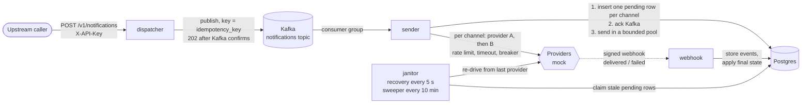
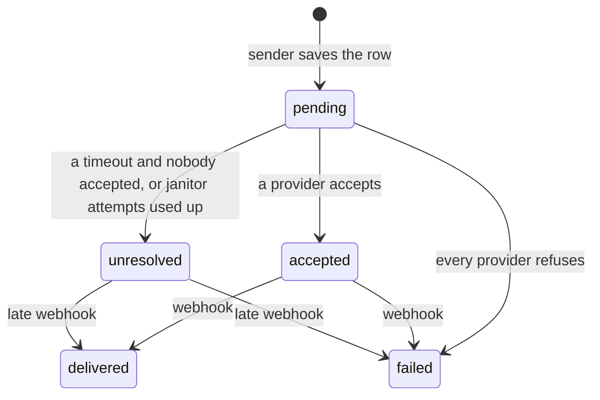

# Eshaar: solution document

Eshaar delivers one notification for one user over email, SMS and WhatsApp through external providers (simulated by a mock), at a target peak of 500,000 requests per second with delivery in under 5 seconds. It is written in Go on Postgres and Kafka.

This document explains the design and its reasons and reports what the load test showed. It is built on `docs/decision_log.md`, which has the full detail of each decision; `docs/api.md` documents the endpoints; `docs/load_test.md` has the measurements. The reviewers read the code and do not run it, so everything here is stated rather than assumed.

**AI agent conversation:** the work was done with Claude Code, and each phase has a log of its session in `docs/sessions/` (flow, changes from the plan, review findings acted on, verification).

## Contents

1. [Summary of results](#1-summary-of-results)
2. [Architecture](#2-architecture)
3. [How a notification moves](#3-how-a-notification-moves)
4. [Main trade-offs](#4-main-trade-offs)
5. [Main difficulties](#5-main-difficulties)
6. [Load test and provider failure](#6-load-test-and-provider-failure)
7. [Reaching 500K requests per second](#7-reaching-500k-requests-per-second)
8. [Other notes: PII and testing](#8-other-notes-pii-and-testing)
9. [What I would do differently with more time](#9-what-i-would-do-differently-with-more-time)

## 1. Summary of results

- The design is complete and tested end to end: dispatcher, sender, provider fallback with circuit breakers, webhooks, and two janitors that recover what stalls.
- On one 4-core machine shared with Kafka, Postgres and the load generator, one dispatcher accepted about 14,800 requests/s with a p99 under 100 ms.
- The first bottleneck is **not the dispatcher but Postgres**: one sender with a default Postgres sustained about 900 requests/s (three channels each, so 2,700 rows/s) before delivery fell behind. The cause is measured: one commit per notification for the `accepted` update. The fix is known (batch the outcome writes) and is not built; it is the first item in section 9.
- A failing, slow or rate-limited provider costs nothing to the caller: requests keep getting `202` and the sender falls back to the next provider. Both providers of a channel down leaves rows `pending` and recovery is slow at the default janitor settings (10 rows/s).
- 500K req/s is **not reached or demonstrated**; section 7 extrapolates from the measurements and says what has to change.

## 2. Architecture

The code is hexagonal. The domain (notification, channel, forward-only state machine) imports nothing. Ports are interfaces for publishing, consuming, storing and sending. Adapters (Kafka, Postgres, mock provider, HTTP) implement them and never import each other. Only the `cmd/*` entry points wire adapters to ports. The services (`internal/sender`, `internal/webhook`, `internal/janitor`) import only the domain and ports, so Kafka, Postgres or a provider can be replaced without touching them.

Each of dispatcher, sender, webhook and janitor is a separate process, so each scales and fails on its own. `cmd/migrate` applies the schema and exits. Infrastructure is docker-compose (`infra/`), not Kubernetes.

## 3. How a notification moves

1. **Dispatcher.** Checks the API key, applies an in-memory per-key rate limit, validates the request, publishes it to Kafka keyed by the idempotency key, and answers `202` only after Kafka confirms. Keying by idempotency key spreads load evenly; keying by recipient would let one busy user create a hot partition, and ordering between a user's notifications is not required.
2. **Sender, save first.** One consumer of a group reads a batch, inserts one `pending` row per channel in one statement (unique on idempotency key and channel), and only then acknowledges Kafka. A redelivery hits the unique constraint and is treated as already saved. Saving before sending is deliberate: a send that succeeded with no row on record would be repeated on every redelivery.
3. **Sender, send.** The sends run in goroutines bounded by a pool, off the consume loop; when the pool is full the consumer stops reading and the backlog waits in Kafka. Each channel has a chain of providers ordered by priority. A call is tried with its own rate limit, timeout and circuit breaker. A failure, a rate-limit answer or an open breaker moves to the next provider at once. A timeout first asks that provider for the message's status by idempotency key (if it supports it) and only then moves on. The chain's final outcome (`accepted`, `failed` or `unresolved`) is written to the row and every attempt is logged.
4. **Webhook.** Checks each event's HMAC signature, stores events in batches (unique on provider and event id), answers `200` only after they are stored, and links them to rows by the provider's message id. A resolver loop links events that arrived before the accept was recorded. Webhooks only record the final state; they never trigger a fallback.
5. **Janitors.** The recovery job re-drives `pending` rows with no outcome after 10 seconds, up to 3 times, resuming from the last provider called and checking its status first. The sweeper marks rows that used their attempts `unresolved`. Both claim rows with one atomic statement, so two instances never take the same rows.

Transitions only move forward, so a late or duplicate event cannot undo a final state. The only way back from a dead end is the late webhook for an `unresolved` row.

## 4. Main trade-offs

| Decision | Why | What it costs |
| --- | --- | --- |
| Save the row before sending | Makes redeliveries and re-drives safe; every outcome has a row | A Postgres write sits on the hot path and is the first bottleneck (section 6) |
| Ack Kafka after the insert, send afterwards in goroutines | The consume loop never waits on a provider, so provider latency does not cause consumer lag | A crash after the ack leaves a `pending` row that only the janitor will send, 10 seconds later at the earliest |
| Kafka key is the idempotency key | Even partitions, no hot user | No ordering between one user's notifications |
| Fallback after a timeout even when the provider cannot report status | Delivery within the time target matters more than one duplicate | A notification can be delivered twice. For providers that can answer a status check the duplicate is avoided |
| Webhooks never trigger fallback | Keeps the send path simple and avoids a second source of sends | A provider that accepts and later reports failure leaves the row `failed` |
| One row per channel | Channels succeed and fail independently, and each carries its own state | More rows (up to three per request) and more writes |
| In-memory rate limiter | No shared state on the hot path | The limit is per dispatcher instance, not global |
| Circuit breaker counts consecutive failures | Simple and cheap | Reacts late to a flaky provider and then sends all traffic away from it (seen in the 50 % failure run) |
| Outbound limiter queues instead of rejecting, and the wait counts against the timeout | Smooths bursts | Under sustained overload the overflow waits the full 2 s before falling back (seen in the rate-limit run) |
| Janitor re-drive window of 10 s | Quick recovery of stalled rows | A healthy row waiting in a saturated pool can be re-driven; the status check and the attempt limit bound the duplicate |
| Attempt limit is a constant (3) | The partial indexes need it as a literal | Not tunable at runtime |
| Webhook endpoint accepts only `delivered` and `failed` | Only final states are recorded | A real provider's intermediate statuses would need a mapping layer |
| Hexagonal layout with several processes | Replaceable adapters, independent scaling | More wiring in `cmd/*` than a single binary |

## 5. Main difficulties

- **Never losing a notification without sending it twice.** Kafka at-least-once delivery, a sender that can crash between acknowledging and sending, and providers that can take a message and lose the reply all push toward duplicates or losses. The answer is layered: a unique constraint on `(idempotency_key, channel)`, save-then-ack, a status check by idempotency key before moving on from a timeout or re-driving, forward-only states, and the janitors for whatever remains. Where nothing can prove what happened (a provider that cannot report status), the duplicate is accepted and documented.
- **Re-driving without fighting the original send.** A row waiting in a saturated pool looks stalled to the janitor. The 10-second window is a decision, not a proof, and the code refuses configurations where a re-drive could outlast it (`janitor.New` rejects a send budget over the stale age). A provider skipped by an open breaker could also sit before `last_provider` and never be tried again; the resume now wraps around to the providers before it.
- **Events that arrive before the accept.** A provider can report delivery before the sender records `accepted`. Such events are stored unlinked and a resolver loop links them later, only matching by key for an `unresolved` row so that a late event from the provider a send fell over from cannot overwrite the outcome of the one that took it.
- **One bad event must not stop a stream.** A webhook the database cannot store would fail its whole batch, and the provider would retry forever; the body is checked for what `jsonb` cannot hold, and a failed batch is retried one event at a time. In the same spirit an undecodable Kafka record is logged and skipped so one poison message cannot stall a partition (there is no dead-letter topic).
- **Making a mock stand in for real providers.** The load test needed a provider that is slow or flaky. The mock's behaviour is now set from `providers.yaml`, so the real processes can be tested rather than only the Go tests (decision log, Load test).
- **Finding the real bottleneck.** The first expectation was that the sender's goroutine pool or the dispatcher would limit throughput. Measuring showed Postgres at 80 to 90 % CPU while the sender used 30 %, then two experiments (a bigger pool, then `synchronous_commit=off`) showed the commit per row to be the limit (section 6).

## 6. Load test and provider failure

Full tables, setup, and commands are in `docs/load_test.md`. The test ran on one 4-core machine with everything on it, so the numbers are lower bounds for each part.

**Throughput.** One dispatcher accepted up to about 14,800 requests/s with no failed request. One sender with a default Postgres kept up to 600 requests/s (1,800 rows/s) and sustained about 900 (2,700 rows/s); at 1,200 requests/s the backlog took 13 seconds to clear after the run ended, which breaks the 5-second target. In the runs that kept up, the time from the sender's insert to the provider's accept was a median of 3 ms and a p99 under 50 ms.

**Bottleneck.** Postgres, because `MarkAccepted` is a separate transaction and WAL flush for each row. Evidence: Postgres at 79 to 89 % CPU against the sender's 23 to 34 %; 26,500 commits for 27,000 accepted rows in 10 seconds; no improvement from a pool four times larger (p99 worse); and at 1,200 requests/s a median of 5 ms instead of 378 ms with `synchronous_commit=off`. That setting weakens durability, so it is evidence, not a fix.

**Micro-benchmarks** (`docs/benchmarks.md`) give the cost of each piece and agree with the load test. The dispatcher handler takes 36 microseconds per request on one CPU and about 185,000 requests/s on four, of which `Request.Validate` is 26 microseconds; a channel send in the sender takes 7 to 10 microseconds, and the circuit breaker and outbound limiter a few hundred nanoseconds each; the webhook service handles an event in 7.5 microseconds at throughput. None of that explains the 900 requests/s limit. The Postgres outcome write does: one `UPDATE` and commit per row reached 3,700 to 4,600 rows/s from one goroutine and 9,500 to 11,500 from 128, and the same update for 100 rows in one statement reached 33,000 to 40,000 rows/s, roughly **3 to 4 times** the per-row rate (about 3.5 at the mid-points). Inserts of 150 rows in one statement ran at 24,000 to 26,000 rows/s.

**When a provider fails** (600 requests/s of email and SMS for 30 seconds, `sms-a` failing):

| Failure of `sms-a` | What happened |
| --- | --- |
| Every call fails | The breaker opened after 5 failed calls; the remaining 17,994 skipped the provider without a call; all SMS went to `sms-b`; p99 45 ms; nothing lost |
| Half the calls fail | The breaker opened after 24 failures and then sent everything, even the calls that would have worked, to `sms-b` |
| Slower than its 2 s timeout | 258 requests waited out the timeout (p99 2.1 s, max 3.6 s), then the breaker opened and the cost disappeared; all SMS accepted by `sms-b` |
| Rate limited to 100/s | 3,009 accepted by `sms-a`, the rest waited up to the 2 s timeout and fell back: p95 2.0 s |
| Both SMS providers down | Rows stay `pending` (17,988 of them), email unaffected, the dispatcher kept answering `202` at p99 6.5 ms. The janitor recovers 10 rows/s by default, so draining that backlog would take about 30 minutes |

In none of these runs was a notification lost or an error returned to the caller. The one that needs attention is the last: recovery from a long outage is slow at the default settings and some rows could exhaust their 3 attempts and become `unresolved` while the providers are still down.

## 7. Reaching 500K requests per second

Instances needed = 500,000 divided by the rate per instance. The results below are estimates from the measurements above, not a test of 500K.

- **Dispatcher.** At least 14,800 req/s per instance on a shared machine, so about 34 instances or fewer behind a load balancer. The in-memory rate limit becomes a per-instance limit and needs a shared or edge limiter if a global limit matters.
- **Kafka.** 12 partitions are far too few: a consumer group cannot have more active consumers than partitions. Use 64 or more, replication of 3, a producer that batches and compresses, and watch consumer lag, which is the signal that the sender fell behind and which the janitors cannot see.
- **Sender.** CPU is not the limit: about 0.3 of a core at 5,500 rows/s, or roughly 24,000 requests/s per 4-core instance if the database could take the writes, so about 21 instances.
- **Postgres is the limit.** At 500K req/s with three rows per request the peak is 1.5M inserted rows/s plus the same number of updates, and the decision log counts about three writes per notification including the webhook's final state. At the measured 2,700 rows/s per node with a commit per row this is over 550 nodes. The changes that matter, in order:
  1. **Batch the outcome writes.** `InsertPending` already inserts a whole batch in one statement; `MarkAccepted` should write a batch of outcomes in one `UPDATE ... FROM unnest(...)` and webhook states are already applied in batches. The benchmark of exactly that statement for 100 rows is roughly 3 to 4 times the per-row parallel rate (33,000 to 40,000 against 9,500 to 11,500 rows/s).
  2. **Shard `notifications` by a hash of the idempotency key** across several primaries; the insert, outcome and janitor statements all carry the key or a row id.
  3. **Cut index maintenance on the hot path.** The updates are not HOT because they change indexed columns.
  4. **Retention.** `webhook_events` and `notifications` need partitioning by time and a drop plan.
- **Latency target.** With a sender that keeps up, the insert-to-accept time was milliseconds. The 5-second target holds only while the backlog stays small; the number to alert on is Kafka consumer lag, not row age.

## 8. Other notes: PII and testing

**PII.** Each channel row stores the recipient's email address or phone number and the message content. That is acceptable here and would need, in production, encryption at rest, a retention period and deletion by `recipient_id`, access controls on the database, and care that the logs stay free of contact details (no log call prints an address or number today).

**Testing.** Every phase has unit tests and end-to-end tests (`cmd/*/e2e_test.go`) that run the real adapters against Postgres and Kafka started with testcontainers; they are skipped under `-short` or without Docker. `make verify` (format, vet, golangci-lint, tests with the race detector) runs before each commit through a git hook and in CI on each pull request.

## 9. What I would do differently with more time

1. **Batch the outcome writes** (section 7). It is the most valuable change and both the load test and the micro-benchmarks (roughly 3 to 4 times the per-row rate) point straight at it.
2. **A transactional outbox or direct write path.** The dispatcher publishes to Kafka and the sender then writes to Postgres. For lower latency and fewer moving parts, the dispatcher could write batches to a sharded store and publish from there, at the cost of making the dispatcher depend on the database.
3. **A different store for the hot path.** A log-structured or wide-column store, or Postgres with a narrow `pending` table and a separate history table, would cost less per state change than updating one wide, heavily indexed row.
4. **Recovery that scales.** Make the janitor's rate adapt to the backlog, add an operator command to re-drive a channel after an outage, and a dead-letter topic for undecodable Kafka records.
5. **A better breaker and limiter.** A failure-rate window instead of consecutive failures, a short bound on how long the outbound limiter may make a call wait, and limiter and breaker state shared across sender instances.
6. **Real provider adapters** with their own status mapping (intermediate statuses, correcting events) and idempotency support, and a contract test per adapter against the mock.
7. **Observability.** `log/slog` is the only signal today. Metrics for pool occupancy, consumer lag, breaker state, and janitor re-drives, traces across the Kafka hop, and alerts on those, in the same stack for all four processes.
8. **A load test that is not on one machine.** Separate hosts for the generator, Kafka, Postgres and each service, real network, and a mock with realistic provider latency, so the extrapolation rests on measured per-instance rates for each tier.
